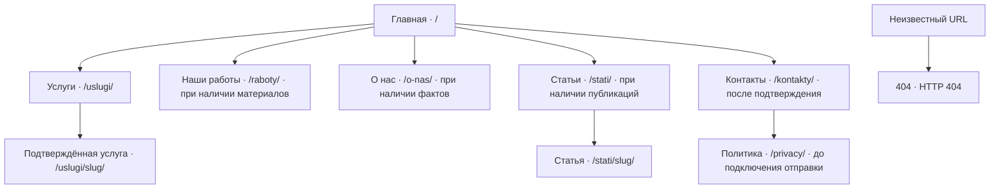
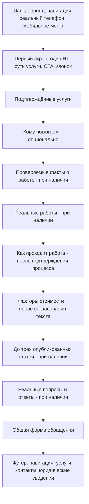
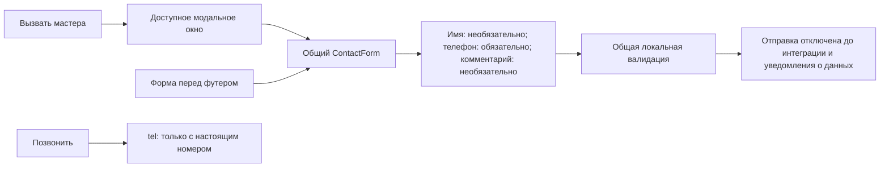
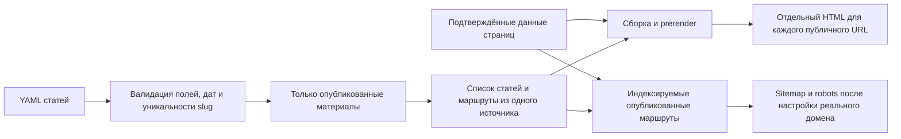

# Схема сайта

Основание: [SITE_CONTENT_BLUEPRINT.md](SITE_CONTENT_BLUEPRINT.md) и
[AGENTS.md](../AGENTS.md). Это схема для согласования, а не список уже созданных
страниц. Разработка и проверка — локально на localhost, без публикации.

## Карта страниц



Связи показывают информационную иерархию. Политика также доступна из футера
и рядом с формами после подготовки юридического текста.

| Страница          | Условие реализации и публикации                                            |
| ----------------- | -------------------------------------------------------------------------- |
| Главная           | Каркас уже есть; наполнение после подтверждения бизнеса, языка и географии |
| Услуги            | Только подтверждённый перечень, без пустого каталога                       |
| Конкретная услуга | Реальная услуга и самостоятельное полезное содержание                      |
| Наши работы       | Реальные фотографии, описания и права на публикацию                        |
| О нас             | Подтверждённые сведения о мастере или компании                             |
| Статьи и статья   | Реальные опубликованные материалы из YAML; без пустого раздела             |
| Контакты          | Настоящие контакты и территория обслуживания                               |
| Политика          | Согласованный текст до включения передачи персональных данных              |
| 404               | Техническая страница уже есть, исключается из индексации                   |

`/stati/` — предложение блюпринта. В AGENTS.md пока приведён пример
`/articles/<slug>/`. До реализации статей выбираем единый путь и синхронизируем
документы, маршруты и генератор. Обе версии параллельно не создаём.
`/ceny/` не входит в текущую карту: отдельную страницу рассматриваем только
при наличии реального прайса и отдельного решения.

## Главная: сверху вниз



Условные блоки исключаем целиком, если для них нет проверенных материалов.
Название, телефон, город, фотографии, цены и преимущества не выдумываем.
Список навигации содержит только доступные страницы.

## Схема компонентов

```text
SiteLayout
├── Header
│   └── MobileMenu
├── Основное содержимое страницы
│   ├── Главная
│   │   ├── Hero
│   │   ├── ServicesGrid
│   │   ├── Условные блоки с подтверждённым контентом
│   │   ├── ProcessSteps
│   │   └── ArticlesPreview
│   ├── Услуги / конкретная услуга
│   ├── Статьи / статья
│   └── Остальные согласованные страницы
├── ContactForm — перед футером на предусмотренных страницах
├── Footer
└── ContactModal
    └── ContactForm — тот же компонент и валидация
```

Это план ответственности компонентов. Создаём их по мере реализации;
пустые компоненты и папки заранее не добавляем. Данные услуг хранятся отдельно
от JSX; публичный вывод требует подтверждения и флага публикации.
SEO-метаданные задаются для конкретной страницы в общем HTML-layout.

## Обращение к мастеру



На этапе локального прототипа режим формы явно обозначен: без сетевых запросов,
сохранения данных и сообщения об успешной отправке. Номер телефона совместим
с Беларусью. Модальное окно открывается только по действию пользователя,
поддерживает Escape, управление фокусом и клавиатуру.

## Шаблоны внутренних страниц

**Услуга:** хлебные крошки → H1 → описание задачи → состав работ → типичные
ситуации → факторы стоимости → порядок заказа и CTA → реальные фотографии
(если есть) → полезные FAQ → связанные услуги и статьи → общая форма → футер.

**Список статей:** H1 → краткое введение → карточки опубликованных материалов.

**Статья:** хлебные крошки → H1 → реальные даты → обложка (если есть) → оглавление
(для длинного текста) → Markdown с H2/H3 → релевантные статьи и услуга → общая
форма → футер.

## Статическая генерация и SEO



Текущий каркас остаётся `noindex`. Canonical, sitemap и структурированные данные
готовим по реальным данным; черновики и 404 в sitemap не включаем. Поведение
будущих дат статей согласуем до реализации. Неизвестные URL возвращают HTTP 404.

## Последовательность работы

1. Согласовать карту, направление бизнеса, язык, территорию, бренд и контакты.
2. Собрать mobile-first layout, шапку, меню, футер и первый экран на localhost.
3. Добавить общую форму и модальное окно без отправки.
4. Заполнять услуги и остальные блоки только подтверждёнными материалами.
5. Согласовать URL статей, реализовать YAML-пайплайн и статические страницы.
6. После получения домена и готового контента завершить SEO и подготовку публикации.

При реализации проверяем ширины 320, 375, 390, 768, 1024 и 1440 px,
клавиатуру, сенсорное управление, прямые URL и HTML без JavaScript.
Доставка заявок подключается отдельно после выбора способа и подготовки
уведомления о персональных данных.
